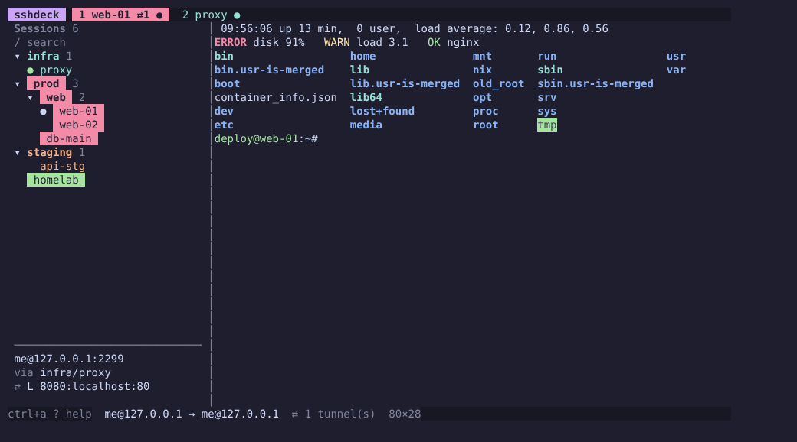

# sshdeck

[](https://github.com/holdemlab/sshdeck/actions/workflows/ci.yml)
[](https://github.com/holdemlab/sshdeck/releases)
[](https://pkg.go.dev/github.com/holdemlab/sshdeck)
[](https://goreportcard.com/report/github.com/holdemlab/sshdeck)
[](LICENSE)

Українською: [README.uk.md](README.uk.md)

A terminal SSH session manager with tabs, in the spirit of MobaXterm / Ásbrú.
Written in Go with [Bubble Tea v2](https://github.com/charmbracelet/bubbletea).
It has a built-in SSH client and terminal emulator, so it needs neither the
system `ssh` nor tmux, and it does not read `~/.ssh/config`. It builds into a
single static binary.



## Features

- **Tabs** with a full terminal: vim, htop, mc, colors, resizing, scrollback.
  Controlled with a prefix (`ctrl+a`, configurable).
- **Session tree** with folders and nested folders. You create, rename, move
  and copy folders right in the tree; there is search. Folded folders
  (including all at once: `H` / `L`) are remembered between runs.
- **Inheritance:** `user`, `port`, `jump`, `identity` are set on a folder and
  apply to everything inside.
- **Mouse:** click tabs and the tree, scroll with the wheel, drag the
  sidebar edge; vim, htop and mc in the tabs get the mouse too.
- **Local shell:** the `local` entry at the top of the tree (or `ctrl+a l`)
  opens a tab with a shell on this computer, next to your SSH tabs.
- **Jump hosts and chains** (like `ProxyJump`), with its own key on each hop.
- **Authentication:** keys (including with a passphrase), ssh-agent,
  keyboard-interactive, password. Prompts appear right in the tab. Accepted
  passwords are kept only in memory until you quit. `ctrl+a k` installs your
  key on the server, like `ssh-copy-id`.
- **Its own known_hosts** with confirmation of new keys and blocking of changed
  ones.
- **Tunnels** `L` / `D` (SOCKS5) / `R`: autostart from the session, adding on
  the fly, tunnels-only mode.
- **Settings** are edited in the app (`ctrl+a ,`) or in `$EDITOR`.
- **Color marks** for folders and sessions (text and fill, `C`): environments
  stand out in the tree and on the tabs.
- **Color schemes** [Catppuccin](https://catppuccin.com/): Latte, Frappé, Macchiato, Mocha,
  or your terminal's own colors. They paint sshdeck and the programs in the tabs.
- **Two languages:** Ukrainian and English interface and help, picked in settings (`language: auto | uk | en`).

## Install

Linux binaries (amd64, arm64) and `.deb` / `.rpm` / `.apk` packages are on
[Releases](https://github.com/holdemlab/sshdeck/releases). Anywhere else,
install with Go 1.26+:

```sh
go install github.com/holdemlab/sshdeck/cmd/sshdeck@latest
```

From source:

```sh
git clone https://github.com/holdemlab/sshdeck && cd sshdeck
make            # builds bin/sshdeck; `make help` lists the other tasks
./bin/sshdeck
```

Details: [docs/getting-started.md](docs/getting-started.md).

## Quick start

`N` creates a folder, `n` a session, `enter` connects, `ctrl+a ?` shows help.

## Documentation

Short help is built into the app: `ctrl+a ?` (or `?` in the tree). It is the
file [`docs/help.md`](docs/help.md), shown with formatting, scrolling and
search.

The docs are also available in Ukrainian: [`docs/uk/`](docs/uk/).

| Section | About |
|---|---|
| [Help](docs/help.md) | all the essentials on one page: key bindings, jump, SSH keys, tunnels, files |
| [Getting started](docs/getting-started.md) | build, files, flags, first session |
| [Sessions and folders](docs/sessions.md) | `sessions.yaml` format, inheritance, editing the tree in the UI |
| [Jump hosts](docs/jump-hosts.md) | connecting through intermediate servers, chains, **different keys on the jump and on the target** |
| [Authentication and known_hosts](docs/authentication.md) | key order, passphrases, passwords, server keys, keepalive |
| [Tunnels](docs/tunnels.md) | `L` / `D` / `R`, tunnels panel, tunnels-only mode |
| [Settings](docs/settings.md) | all `config.yaml` options, settings screen, prefix and tmux |
| [Keys](docs/keys.md) | the full list of keys |
| [Troubleshooting](docs/troubleshooting.md) | what error messages mean and what to do about them |

Example sessions config: [`examples/sessions.yaml`](examples/sessions.yaml).

## Code structure

```
cmd/sshdeck/          entry point, flags
internal/config/      sessions.yaml and config.yaml: types, load/save, inheritance, tree operations
internal/sshclient/   SSH client: routing through jump hosts, authentication, known_hosts, pty
internal/tunnel/      tunnels L / R / D (SOCKS5), stats
internal/localshell/   local shell tabs (pty)
internal/sshtest/     built-in SSH server for tests
internal/ui/          Bubble Tea: tabs, sidebar, forms, tunnels, settings
internal/i18n/        interface translations (English keys → Ukrainian)
docs/                 documentation (en), docs/uk/ (uk); help.md and uk/help.md are embedded (docs.go)
```

## What's next

1. **Multi-exec**: typing into several tabs at once (like cluster in Ásbrú).
2. **SFTP browser**: a two-pane file manager.
3. **Splits**: two tabs side by side in one window.
4. ssh-agent forwarding.

Ideas and votes are welcome in [issues](https://github.com/holdemlab/sshdeck/issues).

## Contributing

Bug reports, translations and pull requests are welcome. See
[CONTRIBUTING.md](CONTRIBUTING.md) for how to build, test and send changes, and
[SECURITY.md](SECURITY.md) for reporting vulnerabilities privately.

## License

[MIT](LICENSE) © holdemlab
